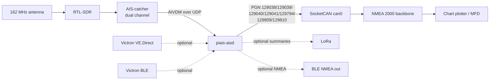

# piais

**SDR → AIS → NMEA 2000 on a Raspberry Pi — Zero 2 W minimum.**

An RTL-SDR listens to the two AIS VHF channels. A PiCAN 2 puts the decoded
targets onto the boat's NMEA 2000 backbone as standard AIS PGNs. The Pi runs
from RAM with no writable root filesystem, so a power cut cannot corrupt the
SD card. The same box is designed to grow into VE.Direct telemetry, sensors,
BLE and LoRa.

**Hardware baseline.** The Zero 2 W is the smallest board this is designed to
run on: one PL011 UART (normally Bluetooth), one USB OTG port and 512 MB. Any
larger 64-bit Pi with a 40-pin header works and is the better choice once you
add electrical inputs: Pi 4/CM4-class boards add USB ports and can expose
extra hardware UARTs (`uart2`–`uart5`) for VE.Direct, so the Zero's
single-UART/Bluetooth trade-off disappears. See
[`docs/HARDWARE.md`](docs/HARDWARE.md).

> **Status: working AIS core, no boat hardware yet.** The AIS decode → PGN →
> CAN-frame path is implemented and covered by 58 tests that use the real
> canboat PGN database. Electrical telemetry beyond PGN 127508 is at the
> feasibility stage ([`docs/ELECTRICAL.md`](docs/ELECTRICAL.md)). Nothing here
> has been run against a PiCAN 2, an RTL-SDR, a Victron device or a live
> NMEA 2000 bus.

---

## Other projects

The pieces exist, but not as one open appliance:

| Approach | Covers | Limit |
| --- | --- | --- |
| AIS-catcher `-I can0` | AIS → N2K | experimental; AIS only; no electrical data or piais-level rate limiting |
| Victron GX device (NMEA 2000-out) | Victron electrical → N2K | a second computer (Cerbo/Ekrano); no AIS receiver; extra cost and power |
| Digital Yacht veKonvert | one VE.Direct device → N2K | commercial; one input; no AIS or BLE |
| Signal K + `signalk-to-nmea2000` | AIS and electrical, via plugins | Node server; more RAM and moving parts than this appliance should need |
| **This repository (piais)** | AIS + electrical on one N2K identity | AIS path works; electrical is at the feasibility stage |

The gap is a **cheap, open, single-box N2K node that publishes AIS and
electrical telemetry together**, with PGN mappings owned and tested here, and
an OS that survives a power cut without a writable root.

Dependencies and licences: AIS-catcher (GPL-3.0, kept as a separate process),
pyais (MIT), canboat/`nmea2000` (Apache-2.0), `victron-ble` (Unlicense). See
[`docs/DECISIONS.md`](docs/DECISIONS.md).

---

## Architecture



The Pi is not a router. AIS-catcher does the DSP; `piais-aisd` does the
protocol conversion; `nmea2000` does address claiming and fast-packet framing.

## Electrical telemetry

The same N2K identity is intended to carry the house shunt and MPPT over
VE.Direct, and Bluetooth-only Victron gear (DC-DC) over BLE. The feasibility,
candidate PGNs, wiring constraints and open questions are in
[`docs/ELECTRICAL.md`](docs/ELECTRICAL.md). Nothing beyond PGN 127508 is
implemented or hardware-tested yet.

## Quick start (no hardware)

```bash
python3 -m venv .venv
.venv/bin/pip install -e '.[dev]'

# Decode one real AIVDM sentence and print the CAN frames it would send:
.venv/bin/python -m piais --dry-run \
  --sentence '!AIVDM,1,1,,B,13`e;R001`PNcD2MH48KQq>P0@;5,0*63'
```

Output (one five-frame fast packet for PGN 129038):

```
INFO piais.n2k: can0 11F80E00 [8] 00 1C 01 88 4B 8B 0E 14
INFO piais.n2k: can0 11F80E00 [8] 01 8F FE 03 26 9A 99 1E
...
```

Run the daemon against a UDP feed:

```bash
.venv/bin/python -m piais --dry-run --log-level INFO
# in another shell, replay a capture (or a single sentence) at 10 msg/s:
./scripts/replay_udp.py my-capture.nmea --rate 10
```

Tests:

```bash
.venv/bin/python -m pytest -q      # 58 passed
```

## On the boat

1. **PiCAN 2**: enable SPI and the MCP2515 overlay, bring `can0` up at
   **250 kbit/s** (not 500 kbit/s), and fit the 120 Ω terminator only if this
   node is at an end of the trunk. See [`docs/HARDWARE.md`](docs/HARDWARE.md).
2. **AIS-catcher**: run it with a UDP output to `127.0.0.1:10110`.
3. **piais**: `piais-aisd --config /etc/piais.toml`, supervised by systemd.
4. **OS**: Raspberry Pi OS Lite + overlayfs, or Alpine diskless. See
   [`os/README.md`](os/README.md).

```toml
# /etc/piais.toml
[ais]
udp_host = "127.0.0.1"
udp_port = 10110
own_mmsi = 244000000        # optional; own ship is not rebroadcast as a target
min_update_interval_s = 2.0
static_update_interval_s = 60.0

[n2k]
interface = "socketcan"
channel = "can0"
preferred_address = 25
dry_run = false
```

## What is implemented

| Area | State |
| --- | --- |
| AIS decode (types 1/2/3, 5, 18, 19, 21, 24) | ✅ tested |
| N2K PGNs 129038, 129039, 129040, 129041, 129794, 129809, 129810 | ✅ tested against canboat 9.0.0 |
| Multipart AIVDM reassembly + NMEA checksum validation | ✅ tested |
| Duplicate/rate limiting, own-MMSI filter | ✅ tested |
| SocketCAN transport, address claim, fast packets | ✅ code path, ⬜ not on hardware |
| VE.Direct parser + PGN 127508 battery status | ✅ tested |
| Victron shunt/MPPT PGNs 127506/127507/127751 | ⬜ feasibility documented |
| Victron DC-DC over BLE | ⬜ feasibility documented |
| Read-only OS recipes, systemd units | ✅ documented, ⬜ not booted |
| Sensors, BLE NMEA output, LoRa | ⬜ design only |
| AIS types 4, 9, 27 | ⬜ not mapped |

## Repository layout

| Path | Contents |
| --- | --- |
| [`PLAN.md`](PLAN.md) | Living plan, decisions, work log, next actions |
| [`docs/RESEARCH.md`](docs/RESEARCH.md) | Prior art, feasibility, bandwidth and power budget |
| [`docs/ARCHITECTURE.md`](docs/ARCHITECTURE.md) | Data flow, failure modes, read-only constraints |
| [`docs/HARDWARE.md`](docs/HARDWARE.md) | PiCAN 2, termination, isolation, power, RF |
| [`docs/SOFTWARE.md`](docs/SOFTWARE.md) | PGN mapping, unit traps, extensions |
| [`docs/ELECTRICAL.md`](docs/ELECTRICAL.md) | Victron shunt/MPPT/DC-DC feasibility, candidate PGNs |
| [`docs/DECISIONS.md`](docs/DECISIONS.md) | Architecture decision records |
| [`docs/REFERENCES.md`](docs/REFERENCES.md) | Links and datasheets |
| [`os/`](os/) | RAM/read-only OS recipes and systemd units |
| `src/piais/` | The daemon and protocol code |
| `tests/` | 58 tests, including a canboat field-order guard |
| `scripts/replay_udp.py` | Replay AIVDM over UDP without a radio |

## Hardware warnings

- **NMEA 2000 is not a power bus for a Pi.** Power the Pi from a proper 5 V
  supply or buck with headroom for the RTL-SDR (about 1 A peak for a Zero 2 W;
  a Pi 4/5 with the same peripherals needs more).
- **The PiCAN 2 is not galvanically isolated.** Check your board revision. A
  ground loop through the Pi's supply and the N2K shield is a real risk; an
  isolated transceiver or isolated DC-DC is worth the money on a boat.
- **120 Ω termination**: exactly two terminators on the trunk. The PiCAN 2
  jumper must be off if this node is a drop.
- **BLE and VE.Direct compete for the Pi's UART on the Zero 2 W.** Its PL011
  is shared with Bluetooth, so two VE.Direct devices need USB-serial adapters
  if BLE is also used. A larger Pi can expose extra UARTs or simply has more
  USB ports. See [`docs/ELECTRICAL.md`](docs/ELECTRICAL.md).
- **A read-only root does not make the hardware immune to power loss.** It
  protects the SD card. Use a UPS/supercapacitor and a hardware watchdog if
  the supply is unreliable.
- AIS-catcher's prebuilt packages are not compatible with the original Pi
  Zero/Pi 1 because of floating-point support. The Zero 2 W (Cortex-A53) and
  every larger 64-bit Pi are fine.

## Licences and disclaimer

- This repository: MIT (see [`LICENSE`](LICENSE)).
- AIS-catcher is GPL-3.0 and is used as a **separate program**, not linked.
- `nmea2000` and canboat are Apache-2.0; `pyais` is MIT.
- NMEA 2000 is a proprietary standard of the National Marine Electronics
  Association. This project is not NMEA certified and is not affiliated with
  NMEA.
- Not for navigation or safety of life. AIS reception is not guaranteed and
  this software has not been validated on water.
