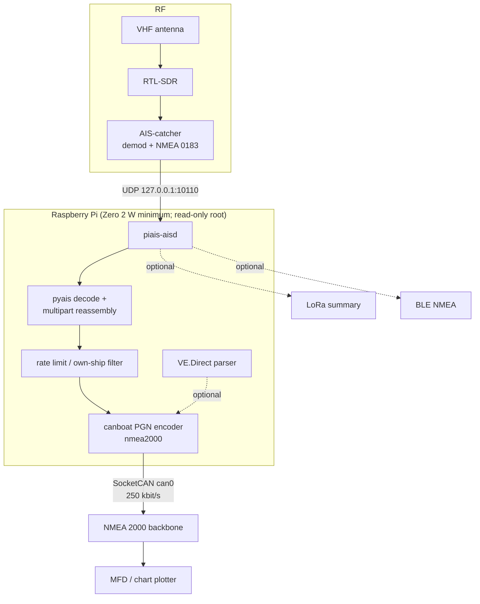

# Architecture

## 1. Data flow

The important boundary: **AIS-catcher is a separate process**. piais reads
NMEA 0183 from it, so the SDR can be swapped for a serial AIS receiver without
touching the protocol layer, and either process can restart independently.
Both are GPL-3.0 now (ADR-012), so the split is operational rather than a
licence firewall.

## 2. Process model

| Process | Owner | Restart policy | Notes |
| --- | --- | --- | --- |
| AIS-catcher | upstream package | systemd/OpenRC | owns the RTL-SDR USB device |
| `piais-aisd` | this repo | always | owns `can0` writes and the UDP socket |
| `can0` setup | oneshot unit | — | `ip link set can0 up type can bitrate 250000` |

Only `piais-aisd` writes to the N2K bus. AIS-catcher must **not** also be
configured with `-I can0`; two writers would fight over address claiming and
duplicate every target. The `-I` option is for the Phase 2 comparison only.

## 3. Threading and concurrency

`piais-aisd` is a single asyncio event loop:

- UDP datagrams arrive through `asyncio.DatagramProtocol`.
- Decoding is synchronous and small; a busy station is ~50 msg/s, far below
  what pyais can do.
- Sending is scheduled as a task per message. `nmea2000` serialises the
  SocketCAN writes; fast-packet frames for one PGN are contiguous.
- The VE.Direct reader runs in a worker thread because `pyserial` is blocking,
  and hands frames back through an `asyncio.Queue`.

There is no database, no disk queue and no persistent state. If the process
dies, it restarts and the next AIS report rebuilds the picture.

## 4. Rate limiting and duplicate suppression

AIS-catcher receives both channels and may hear the same report twice. A busy
harbour can also produce thousands of reports per minute. Sending every one as
a 5-frame fast packet would waste bus bandwidth and fill the MFD's target
list with duplicates.

`AisService._should_send` keeps `(mmsi, kind)` → last-sent monotonic time:

- position reports: at most one per `min_update_interval_s` (default 2 s),
- static reports (type 5, 24A, 24B): at most one per
  `static_update_interval_s` (default 60 s). 24A and 24B use separate keys,
  because they carry different data and must not suppress each other,
- own MMSI: never (configurable),
- the table is pruned after 10 minutes of inactivity.

The limits are deliberately conservative. Raise them if the bus is busy; lower
them if targets look laggy. Measure with `candump` rather than guessing.

## 5. Read-only / RAM constraints

The daemon is designed for a root filesystem that cannot be written:

- no cache directory, no SQLite, no rotating log files,
- configuration is read once from `/etc/piais.toml`,
- logs go to the journal/syslog, which itself lives in RAM or the overlay,
- AIS-catcher's own web UI state should be treated as ephemeral.

If you need a persistent capture for debugging, mount a separate writable
filesystem (USB stick or a small partition) and enable it explicitly. Do not
make the root writable just to keep logs.

## 6. Failure modes

| Failure | Behaviour | Recovery |
| --- | --- | --- |
| RTL-SDR unplugged | AIS-catcher errors/exit | systemd restarts it; piais keeps listening |
| AIS-catcher dies | no datagrams; piais idle | restart AIS-catcher |
| `can0` not up | `N2KDevice.start()` fails | `can0.service` dependency + restart |
| Address claim lost | library renegotiates | automatic |
| Bus goes silent / unplugged | send errors or no ACKs | piais logs, retries on next message |
| Power cut | RAM lost, SD untouched | boot, services restart |
| SD card wear | none — no writes | n/a |
| Clock wrong after boot | timestamps and ETA inference wrong | NTP or GPS; note in runbook |

## 7. Resource budget

Targets, not yet measured on hardware. The Zero 2 W is the baseline; a larger
Pi has more CPU, RAM and USB/UART headroom for the same software.

| Resource | Target | Why |
| --- | --- | --- |
| RAM (piais) | < 80 MB RSS | leaves room for AIS-catcher |
| RAM (AIS-catcher) | < 150 MB | upstream's own footprint |
| CPU (piais) | < 10% of one core | protocol work is tiny |
| CPU (AIS-catcher) | < 60% of one core | with `-F` |
| N2K bus | < 20% utilisation | 5 frames per position report |

If the Zero 2 W struggles, the first lever is AIS-catcher sample rate and
`-F`; the next is a larger Pi (more CPU, RAM and ports). A dedicated AIS
receiver is the alternative if the SDR itself is the bottleneck.

## 8. Security

- The UDP socket binds to loopback by default. Do not expose it to the marina
  Wi-Fi; anyone who can send UDP can inject AIS targets.
- The daemon only sends standard PGNs. It does not accept commands from the
  network.
- If AIS-catcher's web UI is enabled, put it behind the boat's own network and
  a firewall. It has no authentication suitable for exposure.
- The systemd unit drops privileges to a user with only `CAP_NET_RAW`.
