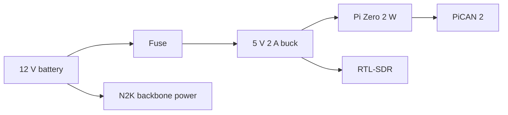

# Hardware

Target: Raspberry Pi Zero 2 W + PiCAN 2 (MCP2515) + RTL-SDR + 162 MHz antenna.

## 1. Bill of materials

| Item | Notes |
| --- | --- |
| Raspberry Pi Zero 2 W | quad Cortex-A53, 512 MB; 64-bit OS |
| microSD, 8–32 GB, high-endurance | class 10 / A1; endurance matters more than speed |
| PiCAN 2 (SK Pang) | MCP2515 over SPI + CAN transceiver; 40-pin HAT |
| RTL-SDR with TCXO | 162 MHz; TCXO strongly preferred |
| 162 MHz antenna | vertical, with ground plane; an AIS-tuned whip beats a wideband scanner antenna |
| SMA/RF cable | short, good quality; every dB counts at 162 MHz |
| 5 V supply or buck | 2 A with headroom and bulk capacitance |
| NMEA 2000 drop cable | M12 5-pin to bare wires or to the PiCAN terminal |
| Heatsink | the Zero 2 W gets warm under SDR load |
| Enclosure | ventilated; RF and power away from the Pi's USB |

## 2. PiCAN 2 setup

The standard PiCAN 2 uses an **MCP2515 with a 16 MHz oscillator** and
interrupt **GPIO 25**. SK Pang's own instructions are:

```
dtparam=spi=on
dtoverlay=mcp2515-can0,oscillator=16000000,interrupt=25
```

On current Raspberry Pi OS the file is `/boot/firmware/config.txt`; older
images use `/boot/config.txt`. Reboot, then:

```bash
sudo ip link set can0 up type can bitrate 250000
ip -details link show can0
```

**NMEA 2000 is 250 kbit/s**, not the 500 kbit/s used for OBD-II. SK Pang's
example uses 500000 because it is written for automotive OBD; do not copy
that value.

If your board revision uses a different crystal, read the marking and change
`oscillator=` accordingly. If `can0` does not appear, check `dmesg` for the
MCP2515 probe and confirm SPI is enabled.

For a PiCAN 2 Duo there is a second controller; the overlay is usually
`mcp2515-can1` with a different interrupt. Check the board's silkscreen and
SK Pang's page rather than guessing.

### Termination

NMEA 2000 is a trunk with **exactly two 120 Ω terminators**, one at each end.
A drop node must **not** add a third. The PiCAN 2 has a termination jumper;
fit it only if the Pi is physically at an end of the trunk. On a short bench
bus, use two terminators and leave the PiCAN jumper off unless it is an end.

### Isolation and ground

The standard PiCAN 2 is **not galvanically isolated** (check your revision).
On a boat, the Pi's 5 V supply ground and the N2K backbone reference can sit
at different potentials, and a ground loop can couple alternator/charger noise
into the bus.

Options, in increasing cost:

1. Power the Pi from the same 12 V source as the N2K backbone, with a good
   buck and a single ground reference.
2. Use an isolated CAN transceiver module (e.g. ADM3053-based) instead of the
   PiCAN's transceiver.
3. Use an isolated DC-DC for the Pi and keep the N2K interface isolated.

Do not connect the N2K shield to the Pi's ground at both ends.

## 3. RTL-SDR

- A TCXO dongle is not optional in practice. AIS channels are 25 kHz wide and
  a drifting dongle loses packets. If you only have a cheap dongle, use
  AIS-catcher's `freqoffset` to correct PPM, and expect worse range.
- Keep the dongle away from the Pi's USB 3 ports and the buck inductor; USB
  noise at 162 MHz is real.
- A short USB extension to move the dongle away from the Pi helps.
- Bias tee: only enable it if the antenna/LNA needs it (`-gr biastee ON`).
- AIS-catcher defaults to 1536 kS/s. On a Zero 2 W, enable `-F` (fixed-point
  downsampling) and measure CPU; consider a lower supported rate if needed.

## 4. Antenna

AIS is vertically polarised. A vertical whip with a reasonable ground plane,
mounted as high as possible, will outperform a random long wire. A dedicated
162 MHz antenna is better than a wideband scanner antenna. Keep the coax
short and avoid sharp bends.

Do not transmit. This project is receive-only.

## 5. Power



- The PiCAN 2 is powered from the Pi's 5 V rail; it does not power the Pi.
- NMEA 2000 backbone power is not a general-purpose supply. Do not hang a Pi
  and an SDR off it.
- Add bulk capacitance (e.g. 470–1000 µF) at the Pi's 5 V input, and a TVS
  diode on the 12 V side if the boat's bus is noisy.
- A UPS or supercapacitor HAT is strongly recommended. A read-only filesystem
  protects the SD card, not the running process or the hardware.
- Measure the actual current with a USB power meter before trusting any
  estimate in this repo.

## 6. Enclosure and environment

- Ventilate the Pi and the dongle; do not seal them in a small plastic box.
- Keep the 162 MHz antenna connector away from the buck converter and the
  Pi's switching regulator.
- Conformal coat or desiccant if the installation is damp. A boat is a harsh
  environment.
- Strain-relieve the USB and N2K cables.

## 7. Bench wiring checklist

Before connecting to the boat:

- [ ] `can0` appears and is up at 250 kbit/s.
- [ ] Exactly two 120 Ω terminators on the bench bus.
- [ ] `candump can0` shows traffic from another node.
- [ ] piais claims an address without a collision.
- [ ] AIS-catcher sees the dongle and decodes a known local vessel.
- [ ] `piais --dry-run` frames decode with `canboat analyzer`.
- [ ] Pi current measured under load.
- [ ] 50 power cuts with the root read-only, then boot and `fsck`.
